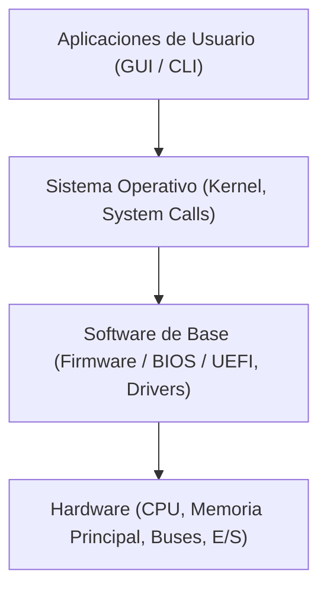

# 1.1 El Sistema Informático: Hardware y Software

Un **sistema informático** es el conjunto de elementos físicos (hardware) y lógicos (software) que interactúan entre sí para procesar, almacenar y recuperar información de forma automatizada [3, 4].

---

## 🏗️ 1. Estructura General del Sistema Informático

El funcionamiento de cualquier equipo informático se basa en la interacción en capas entre sus componentes físicos y sus programas [4, 5]:

---

## ⚙️ 2. Componentes Físicos (Hardware)

El **hardware** engloba todos los componentes tangibles y circuitos electrónicos del equipo [3, 4]. Se organiza en cuatro unidades funcionales principales [3]:

### A. Unidad Central de Proceso (CPU / Procesador)
Es el "cerebro" del ordenador encargado de ejecutar las instrucciones de los programas [3, 6]. Se divide internamente en:
* **Unidad de Control (UC)**: Dirige el flujo de datos y coordina la ejecución de las instrucciones recuperándolas de la memoria principal [3, 6].
* **Unidad Aritmético-Lógica (ALU)**: Realiza las operaciones matemáticas (sumas, restas) y lógicas (comparaciones AND, OR) [3].
* **Registros de la CPU**: Memorias de muy alta velocidad y reducida capacidad situadas dentro del propio procesador para almacenar operandos y direcciones temporales [3].

### B. Memoria Principal
Almacena los datos y programas que la CPU está procesando en tiempo real [3]:
* **Memoria RAM (*Random Access Memory*)**: Memoria de lectura y escritura, volátil (pierde su contenido al apagar el equipo) y de acceso aleatorio.
* **Memoria ROM / Firmware (BIOS / UEFI)**: Memoria no volátil grabada de fábrica que contiene el código de arranque inicial del sistema informático [7].
* **Memoria Caché**: Memoria ultrarrápida situada entre la CPU y la RAM (niveles L1, L2 y L3) que almacena los datos de acceso más frecuente para evitar tiempos de espera [6].

### C. Buses del Sistema
Líneas de comunicación físicas (pistas de cobre o fibra) que conectan la CPU con la memoria y los periféricos [3]:
* **Bus de Datos**: Bidireccional, transporta la información entre componentes.
* **Bus de Direcciones**: Unidireccional, indica la posición exacta de memoria o dispositivo E/S al que la CPU quiere acceder.
* **Bus de Control**: Transporta señales de sincronización y órdenes de lectura/escritura.

### D. Unidades de Entrada / Salida (E/S) y Almacenamiento Secundario
Permiten la interacción con el usuario y la comunicación externa [3]:
* **Dispositivos de Entrada**: Teclado, ratón, escáner.
* **Dispositivos de Salida**: Monitor, impresora, altavoces.
* **Dispositivos de Almacenamiento Secundario (Mixtos)**: Discos duros (HDD), unidades de estado sólido (SSD) y memorias USB [7].

---

## 💻 3. Componentes Lógicos (Software)

El **software** es el conjunto de programas, instrucciones y reglas informáticas que dirigen al hardware para realizar tareas específicas [4]. Se clasifica en dos grandes categorías [4]:

### A. Software de Sistema (o de Base)
Conjunto de programas que gestiona los recursos físicos del equipo y proporciona una interfaz entre el hardware y las aplicaciones del usuario [8]:
* **Sistema Operativo**: Programa principal que administra el procesador, la memoria, los discos y los periféricos (ej. Windows, GNU/Linux, macOS) [7].
* **Firmware (BIOS/UEFI)**: Código alojado en la placa base que realiza el chequeo inicial de hardware (*POST*) e inicia la carga del SO [7].
* **Controladores de Dispositivo (*Drivers*)**: Programas específicos que traducen las órdenes genéricas del sistema operativo a instrucciones entendibles por un componente de hardware concreto [7].

### B. Software de Aplicación
Programas diseñados para que el usuario realice tareas finales [9]:
* **Aplicaciones Horizontales (Generales)**: Procesadores de texto, navegadores web, hojas de cálculo [9].
* **Aplicaciones Verticales (Específicas)**: Software de gestión hospitalaria, diseño CAD, contabilidad [9].
