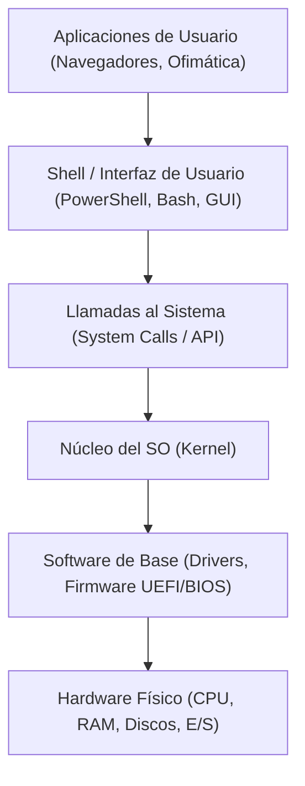
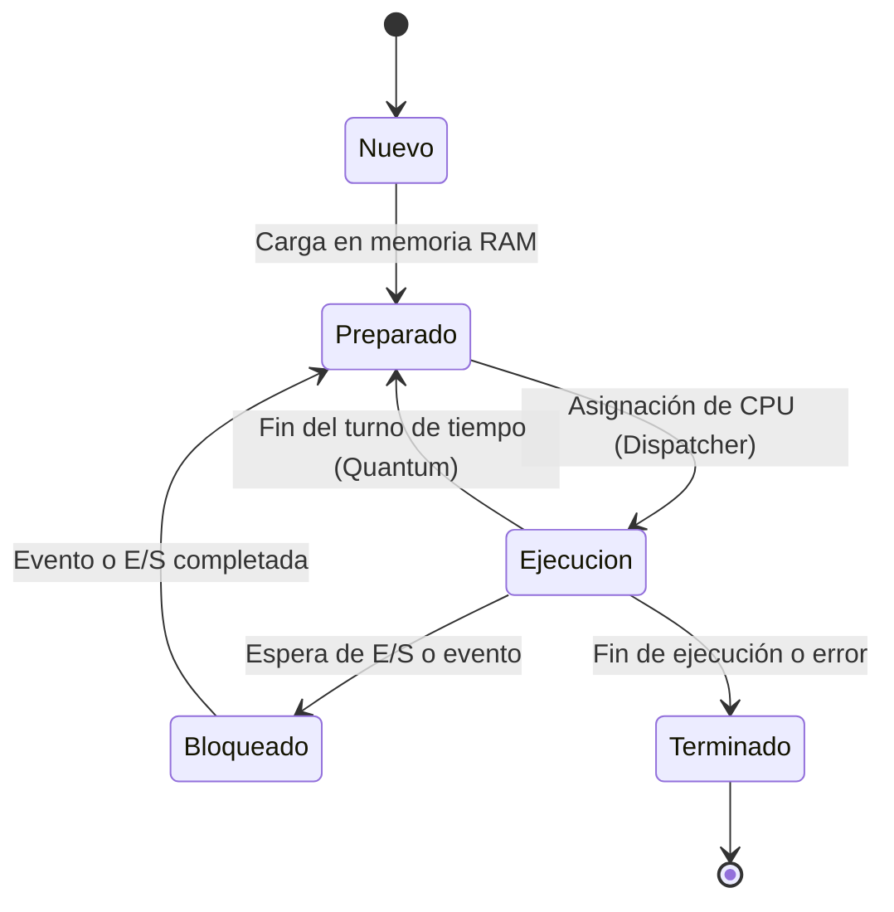

# 2.1 Arquitectura del Sistema Operativo y Gestión de Procesos

Un **Sistema Operativo (SO)** es el conjunto de programas de software de base que administra y optimiza el uso del hardware físico, proporcionando un entorno seguro para la ejecución de aplicaciones y ofreciendo una interfaz adecuada para la interacción con el usuario [5, 6].

---

## ⚙️ 1. Funciones Principales del Sistema Operativo

El sistema operativo actúa como un gestor centralizado de recursos físicos y lógicos [5, 7]:

1. **Gestión del Procesador (CPU)**: Administra el reparto del tiempo de cómputo entre los programas en ejecución mediante algoritmos de planificación [5, 7].
2. **Gestión de la Memoria Principal (RAM)**: Reserva y libera zonas de memoria para cada programa activo, evitando que unos procesos invadan el espacio de otros [7-9].
3. **Gestión de Entrada/Salida (E/S)**: Aísla a los programas de la complejidad física de los periféricos mediante los controladores de dispositivo (*drivers*) [6].
4. **Gestión del Almacenamiento Secundario**: Organiza el árbol de archivos y carpetas en discos duros (HDD) y unidades de estado sólido (SSD) [8, 9].
5. **Seguridad y Control de Acceso**: Autentica a los usuarios y verifica los permisos de ejecución para proteger la integridad del sistema [10, 11].

---

## 🏛️ 2. Arquitectura Interna del Sistema Operativo

Para aislar las aplicaciones de la complejidad del hardware, el sistema operativo se organiza en un diseño modular por capas [9, 12]:

### A. El Núcleo (Kernel)
Es la parte fundamental del sistema operativo que se ejecuta en el modo privilegiado (Kernel Mode) del procesador. Se encarga directamente de la planificación de la CPU, la gestión de memoria y el control del hardware.
### B. Llamadas al Sistema (System Calls)
Son la interfaz estándar mediante la cual una aplicación en modo usuario solicita formalmente un servicio al Kernel (por ejemplo, crear un archivo en disco, reservar memoria o enviar un paquete de datos por red).
### C. La Shell / Interfaz de Usuario
Es la capa exterior que permite la interacción humana con el sistema operativo, ya sea mediante texto (CLI - Command Line Interface como PowerShell o Bash) o mediante ventanas e iconos (GUI - Graphical User Interface).
## 🏗️ 3. Clasificación de los Núcleos (Kernels)
Según su diseño monolítico o modular, los núcleos se dividen en:
| Tipo de Kernel | Características principales | Ventajas | Inconvenientes |  Ejemplos |
| :--- | :---: | :--- | :--- | :--- |
| **Monolítico** | Todos los servicios (procesos, RAM, drivers, red) se ejecutan en el mismo espacio de memoria del Kernel.) | Máxima velocidad y eficiencia en las llamadas internas. | Un fallo en un driver puede provocar el colapso total del sistema. | Linux, BSD |
| **Micronúcleo (Microkernel)** | El Kernel solo mantiene las funciones mínimas (IPC, memoria básica). Drivers y sistemas de archivos van a modo usuario.| Alta estabilidad y modularidad. Si falla un driver, se reinicia solo. | Mayor tiempo de respuesta debido al cambio constante de contexto. | MINIX, QNX |
| **Híbrido** | Estructura modular inspirada en micronúcleos pero ejecutando componentes críticos dentro del Kernel por rendimiento. | Equilibrio óptimo entre velocidad y estabilidad. | Mayor complejidad de diseño interno. | Windows NT, macOS |

## 🔄 4. Gestión de Procesos y Ciclo de Vida
Es imprescindible distinguir entre el concepto pasivo de programa y el activo de proceso:
Programa: Entidad estática almacenada en el disco duro (código compilado o script).
Proceso: Entidad dinámica en ejecución cargada en la memoria RAM con recursos asignados (bloque de control de proceso, contador de programa y registros).
Diagrama de Estados de un Proceso
A lo largo de su existencia en la memoria RAM, un proceso cambia de estado según las decisiones del planificador de la CPU:

1. **Nuevo (New)**: El proceso está siendo creado e inicializado en memoria.
2. **Preparado (Ready)**: El proceso dispone de todos los recursos en RAM y espera a que el planificador le asigne un turno de CPU.
3. **Ejecución (Running)**: Sus instrucciones se están procesando activamente en la CPU.
4. **Bloqueado (Waiting / Blocked)**: Se detiene temporalmente a la espera de un evento externo (lectura de disco, entrada por teclado o recepción de datos).
5. **Terminado (Terminated)**: Finaliza su trabajo y libera todos los recursos de memoria asignados.

## ⏱️ 5. Algoritmos de Planificación de la CPU
El planificador de la CPU decide qué proceso en estado Preparado pasa al estado de Ejecución:
* **FCFS (First-Come, First-Served)**: Atiende a los procesos por estricto orden de llegada.
* **SJF (Shortest Job First)**: Asigna la CPU al proceso cuya ráfaga de ejecución sea la más corta.
* **Round Robin (RR)**: Asigna a cada proceso un turno de tiempo fijo llamado Quantum. Si el proceso no termina durante su turno, vuelve al final de la cola de preparados. 
* **Planificación por Prioridades**: Asigna la CPU al proceso con la prioridad numérica más alta.
## 📁 6. Sistemas de Archivos y Permisos
El sistema de archivos organiza los datos en una estructura jerárquica de árbol a partir del directorio raíz (C:\ en Windows o / en Linux).
Identificación de Rutas:
* **Ruta Absoluta**: Especifica la posición exacta desde la raíz.
  * _Windows_: C:\Users\alumno\Documents\ejercicio.txt
  * _Linux_: /home/alumno/documentos/ejercicio.txt
* **Ruta Relativa**: Especifica la localización a partir de la carpeta actual de trabajo.
  * _Ejemplo_: ..\documentos\ejercicio.txt
## 💻 7. Comandos de Administración de Procesos y Archivos
| Tarea de Administración | Windows (PowerShell) | Linux (Bash) |
| :--- | :--- | :--- |
| **Ruta del directorio actual** | Get-Location / pwd | pwd |
| **Listar archivos y carpetas**  | Get-ChildItem / dir | ls -la |
| **Cambiar de directorio** | Set-Location [ruta] / cd | cd [ruta] |
| **Crear una nueva carpeta** | New-Item -ItemType Directory | mkdir [nombre] |
| **Ver procesos activos** | Get-Process | ps aux / top |
| **Finalizar un proceso** | Stop-Process -Id [PID] | kill -9 [PID] |__

