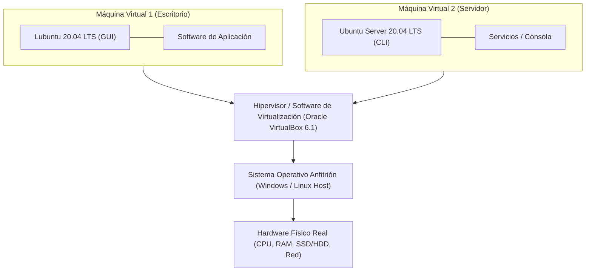

# 3.1 Fundamentos de Virtualización de Sistemas

La **virtualización** es una tecnología que permite crear representaciones basadas en software (virtuales) de recursos físicos como procesadores, memoria RAM, almacenamiento y adaptadores de red [5]. Permite ejecutar múltiples sistemas operativos de forma simultánea e independiente sobre una sola máquina física [5].

---

## 🏗️ 1. Arquitectura Anfitrión (*Host*) vs. Huésped (*Guest*)

En cualquier entorno de virtualización se distinguen dos funciones claramente diferenciadas [5, 6]:

* **Sistema Anfitrión (*Host System*)**: Es el equipo físico real (*hardware*) y su sistema operativo base encargados de proporcionar los recursos de procesamiento, memoria y almacenamiento reales [5, 6].
* **Sistema Huésped (*Guest System*)**: Es el sistema operativo que se ejecuta aislado dentro de la **Máquina Virtual (MV)**, creyendo que dispone de hardware exclusivo [5, 6].

## ⚡ 2. Tipos de Hipervisores (Hypervisors)
El hipervisor o Monitor de Máquinas Virtuales (VMM) es la capa de software responsable de abstraer el hardware físico y distribuirlo entre las distintas máquinas virtuales. Se clasifican en dos tipos principales:
| Característica | Hipervisor Tipo 1 (Nativo / Bare-Metal) | Hipervisor Tipo 2 (Alojado / Hosted) |
| --- | --- | --- |
| Ubicación | Se ejecuta directamente sobre el hardware físico. | Se ejecuta como una aplicación sobre el SO Anfitrión. |
| Rendimiento | Rendimiento muy alto y baja latencia. | Rendimiento medio (sufre la sobrecarga del SO anfitrión). |
| Uso Principal | Centros de Datos (Data Centers) y servidores de producción. | Entornos de desarrollo, pruebas y laboratorios de aula. |
| Ejemplos | VMware ESXi, Microsoft Hyper-V, Proxmox VE | Oracle VM VirtualBox 6.1, VMware Workstation |
.
## 🎯 3. Ventajas e Inconvenientes de la Virtualización
La adopción de la virtualización ofrece notables beneficios en la administración de sistemas, aunque plantea también ciertos condicionantes técnicos:
### Ventajas principales:
1. Ahorro de costes e infraestructura: Aprovechamiento máximo de la capacidad de procesamiento de los servidores físicos reduciendo el consumo eléctrico y espacio en bastidor .
2. Aislamiento y Seguridad: Un fallo, virus o Kernel Panic dentro de una máquina virtual (p. ej., durante las prácticas en consola) no afecta al sistema anfitrión ni a otras MVs paralelas.
3. Portabilidad y Copias de Seguridad: Una máquina virtual se almacena en el disco físico como un conjunto de archivos (ej. archivos .vbox y .vdi en VirtualBox) fáciles de duplicar, clonar o migrar.
4. Entorno de Pruebas Multiplataforma: Permite desplegar sistemas heterogéneos (como Lubuntu 20.04 con entorno gráfico LXQt y Ubuntu Server 20.04 en modo terminal) dentro de un mismo equipo físico.
### Inconvenientes:
1. Sobrecarga de recursos (Overhead): La capa de virtualización consume parte de la memoria RAM y CPU del equipo anfitrión.
2. Punto único de fallo (Single Point of Failure): Si el hardware del sistema anfitrión falla, todas las máquinas virtuales alojadas en él se detendrán simultáneamente.
## 🛠️ 4. Recursos Virtualizados en Oracle VirtualBox 6.1
Al crear una máquina virtual en VirtualBox 6.1, el hipervisor reserva y emula los siguientes componentes lógicos principales:
* CPU Virtual (vCPU): Asignación de núcleos lógicos del procesador del equipo anfitrión a la máquina huésped.
* Memoria RAM Virtual: Reserva de memoria RAM física del anfitrión.
  * _Lubuntu 20.04 Desktop_: Requiere al menos 2048 MB (2 GB) para mover con fluidez el entorno gráfico LXQt.
  * _Ubuntu Server 20.04 CLI_: Requiere solo 1024 MB (1 GB) al carecer de interfaz gráfica de usuario.
* Disco Duro Virtual (.vdi): Fichero que emula la unidad de almacenamiento.
  * _Reservado dinámicamente_: El archivo .vdi en el disco real crece a medida que el sistema huésped guarda datos hasta alcanzar el tamaño máximo fijado (p. ej., 20 GB).
* Adaptadores de Red Virtuales:
  * _Modo NAT_: Proporciona acceso a Internet a la MV ocultándola tras la IP del sistema anfitrión.
  * _Modo Adaptador Puente (Bridge):_ Conecta la MV directamente a la red física del laboratorio como si fuera un equipo independiente con su propia dirección IP.
* 
