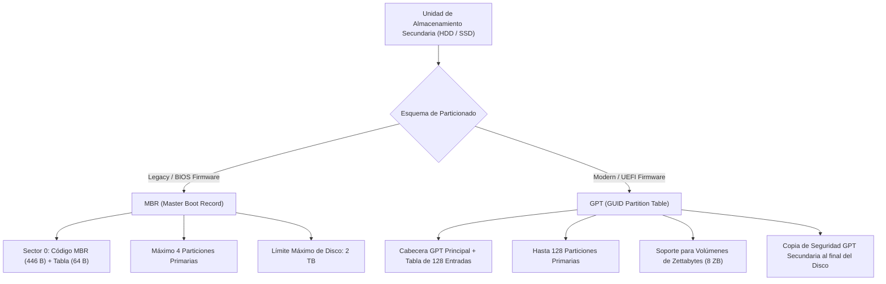
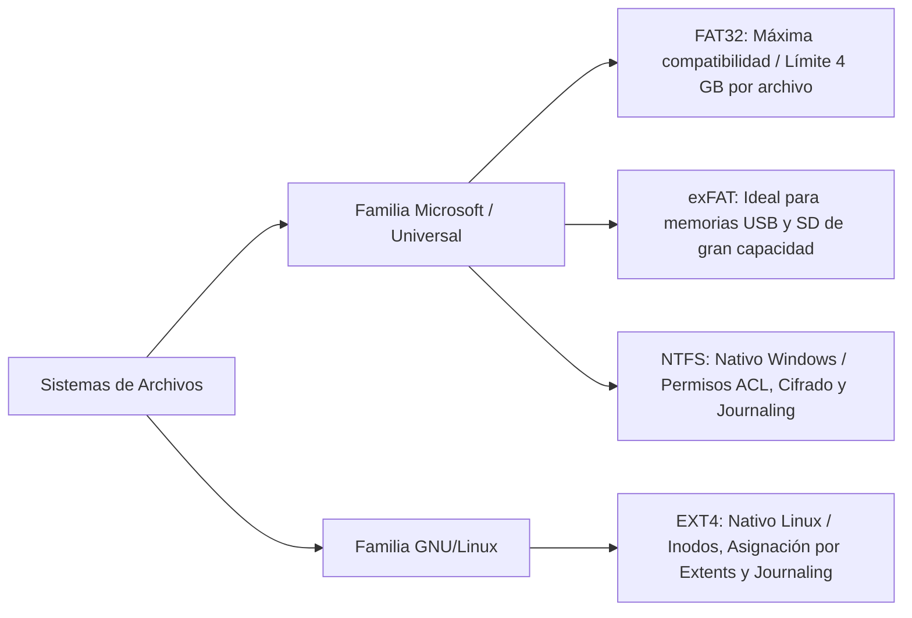

### 4.1 Discos, Particiones y Sistemas de Archivos

* **Unidad Didáctica**: UD4. Instalación de Sistemas Operativos.
* **Resultado de Aprendizaje**: **RA2** (*Instala sistemas operativos monopuesto, evaluando sus características y aplicando técnicas de particionado y configuración*).
* **Criterios de Evaluación**: **CE RA2.a** (*Se ha seleccionado el sistema de archivos adecuado*), **CE RA2.b** (*Se han preparado las unidades de almacenamiento mediante esquemas de particionado*), **CE RA2.c** (*Se han identificado las funciones de los gestores de arranque*).

---

#### 🛠️ 1. Estructura Física y Lógica de las Unidades de Almacenamiento

El almacenamiento secundario mantiene la información de forma permanente (no volátil). Dependiendo de la tecnología de fabricación, los discos se clasifican en:

* **Discos Mecánicos (HDD - Hard Disk Drive)**: Almacenan la información en platos magnéticos que giran a altas velocidades (5400 o 7200 RPM). Un cabezal de lectura/escritura se desplaza físicamente sobre las pistas de los platos.
  * *Estructura geométrica (CHS)*: Se organiza en **Cilindros** (pistas concéntricas alineadas verticalmente), **Cabezas** (lectores de superficie) y **Sectores** (bloques físicos individuales de 512 Bytes o 4 KB en discos *Advanced Format*).
* **Unidades de Estado Sólido (SSD - Solid State Drive)**: Carecen de partes móviles y emplean memorias flash NAND interconectadas mediante un controlador interno.
  * *Interfaz y Factor de Forma*: Conexión SATA III (hasta 600 MB/s) o NVMe sobre bus PCIe M.2 (superando los 3500-7000 MB/s).
  * *Estructura lógica (LBA - Logical Block Addressing)*: El sistema operativo no gestiona la geometría física, sino una secuencia lineal de bloques lógicos numerados de $0$ a $N-1$.

---

#### 📐 2. Esquemas de Particionado: MBR vs. GPT

Para que un disco pueda alojar sistemas de archivos y arrancar un sistema operativo, debe organizarse previamente mediante una **tabla de particiones**. Existen dos esquemas fundamentales:



| Característica | MBR (Master Boot Record) | GPT (GUID Partition Table) |
| :--- | :--- | :--- |
| **Firmware Requerido** | BIOS Legacy / UEFI en modo CSM (Compatibility) | UEFI nativo de 64 bits |
| **Ubicación de la Tabla** | Sector 0 del disco (primeros 512 Bytes) | Sectores iniciales + Copia redundante al final |
| **Límite de Particiones** | Máx. 4 primarias (o 3 primarias + 1 extendida) | Hasta 128 particiones primarias en Windows/Linux |
| **Capacidad Máxima** | **2 TB** ($2^{32}$ sectores de 512 B) | **9,4 ZB** (Zettabytes) |
| **Tolerancia a Fallos** | Nula (si se corrompe el Sector 0, se pierde la tabla) | Alta (utiliza suma de verificación CRC32 y copia espejo) |

---

#### 🗂️ 3. Tipos de Particiones en MBR

En el esquema MBR tradicional, debido a la restricción de 64 Bytes de espacio para la tabla (4 entradas de 16 Bytes), se definen tres clases de particiones:

1. **Partición Primaria**: Es una división directa del disco capaz de alojar un sistema de archivos ejecutable y ser marcada como **Activa** para el arranque del sistema operativo.
2. **Partición Extendida (o Secundaria)**: Tipo especial de partición primaria ideada para superar el límite de 4 particiones. No contiene un sistema de archivos directo, sino que actúa como un contenedor para particiones lógicas. Solo puede existir una partición extendida por disco.
3. **Partición Lógica**: Se crea dentro del espacio delimitado por la partición extendida. Un sistema puede tener múltiples particiones lógicas (útil en Linux para separar `/home`, `/var` o espacio de intercambio `swap`).

::: tip Importante en GPT
En el esquema moderno **GPT no existen las particiones extendidas ni lógicas**; todas las particiones se tratan de forma homogénea como particiones primarias asignadas con un código **GUID único**.
:::

---

#### 💾 4. Sistemas de Archivos: FAT32, NTFS, EXT4 y exFAT

Un **sistema de archivos** es la estructura lógica encargada de asignar nombre, espacio, permisos y mecanismos de recuperación a los datos almacenados en una partición.



| Sistema de Archivos | SO Principal | Tamaño Máx. Archivo | Tamaño Máx. Volumen | Transaccional (*Journaling*) | Características Clave |
| :--- | :--- | :--- | :--- | :--- | :--- |
| **FAT32** | Universal | **4 GB** | 32 GB / 2 TB | ❌ No | Estructura simple; ideal para pendrives pequeños o firmware UEFI. |
| **exFAT** | Universal / Móvil | 16 EB | 128 PB | ❌ No | Evolución de FAT32 sin el límite de 4 GB por archivo; óptimo para tarjetas SD. |
| **NTFS** | Windows 10 / 11 | 8 PB | 8 PB | interiormente de la estructura del volumen (SÍ) | Soporta Permisos ACL, compresión transparente, cifrado EFS y *Journaling*. |
| **EXT4** | GNU / Linux | 16 TB | 1 EB | SÍ (*Journaling* de metadatos/datos) | Utiliza estructura de inodos, asignación por *extents* y comprobación rápida. |

::: info ¿Qué es el Journaling?
Un sistema de archivos con **Journaling (Transaccional)** mantiene un registro diario previo en el que anota las modificaciones pendientes. Si se produce una interrupción abrupta del suministro eléctrico, el sistema lee el registro al reiniciar y restaura la consistencia lógica del disco en cuestión de segundos.
:::

---

#### 🚀 5. Gestores de Arranque (Bootloaders) y Configuración Dual-Boot

El **gestor de arranque** (*Bootloader*) es un programa alojado en el primer sector del disco o en la partición del sistema que toma el control tras la fase de POST e inicialización del Firmware (BIOS/UEFI).

##### A. Funciones Principales del Gestor de Arranque
1. Presentar un menú interactivo de selección al usuario cuando coexisten varios sistemas operativos (**Arranque Múltiple / Dual-Boot**).
2. Cargar en la memoria RAM la imagen comprimida del **Kernel** del sistema operativo elegido.
3. Pasar parámetros de inicialización al Kernel (como la partición raíz `/` o el modo de recuperación).

##### B. Principales Gestores de Arranque
* **GRUB2 (GRand Unified Bootloader)**: Gestor estándar en distribuciones GNU/Linux. Capaz de detectar dinámicamente otros sistemas (Windows, otras distros) mediante la herramienta `os-prober`. Su configuración principal se almacena en `/boot/grub/grub.cfg` (generada a partir de `/etc/default/grub`).
* **Windows Boot Manager (BOOTMGR / BCD)**: Cargador nativo de Microsoft Windows. Almacena sus parámetros en el almacén de datos BCD (*Boot Configuration Data*) y se gestiona con la herramienta de consola `bcdedit`.
* **Partición de Sistema EFI (ESP - EFI System Partition)**: En sistemas UEFI con GPT, es una partición formateada obligatoriamente en **FAT32** que contiene los ejecutables de arranque `.efi` de cada SO instalado (`/EFI/BOOT/bootx64.efi`, `/EFI/ubuntu/grubx64.efi`).

```text
[Proceso de Arranque UEFI Dual-Boot]
1. Encendido / POST de la Placa Base
2. Carga del Firmware UEFI
3. LECTURA de la Partición EFI (ESP) en el disco GPT
4. Ejecución de GRUB2 (/EFI/ubuntu/grubx64.efi)
5. Selección del Usuario:
   ├─► Opción A: Carga Kernel Linux (vmlinuz + initrd)
   └─► Opción B: Cadena hacia Windows Boot Manager (/EFI/Microsoft/Boot/bootmgfw.efi)
```
