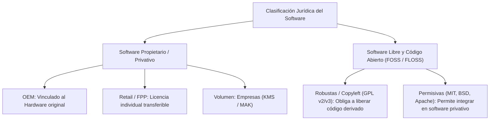
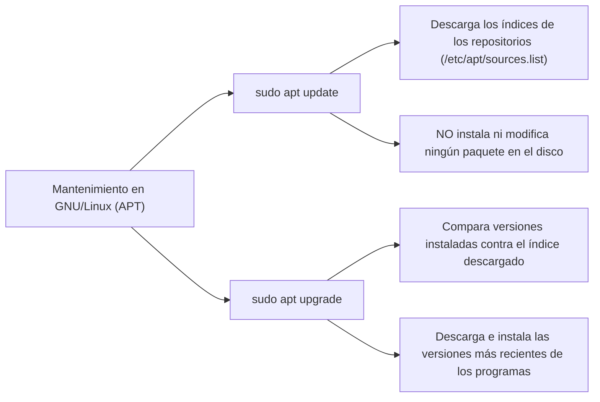

### 4.2 Proceso de Instalación y Licencias de Software

* **Unidad Didáctica**: UD4. Instalación de Sistemas Operativos.
* **Resultado de Aprendizaje**: **RA2** (*Instala sistemas operativos monopuesto, evaluando sus características y aplicando técnicas de particionado y configuración*).
* **Criterios de Evaluación**: **CE RA2.d** (*Se han identificado los tipos de licencias de software*), **CE RA2.e** (*Se han verificado los requisitos de hardware*), **CE RA2.f** (*Se han aplicado los pasos del proceso de instalación*), **CE RA2.g** (*Se han instalado controladores y actualizaciones post-instalación*).

---

#### 📜 1. Licencias de Software y Modelos de Comercialización

Una **licencia de software** es un contrato legal entre el autor/titular de los derechos de autor (*copyright*) y el usuario final, donde se establecen los términos, condiciones y derechos de uso, modificación y distribución del programa.



##### A. Modelos en Software Propietario (Comercial)
* **OEM (Original Equipment Manufacturer)**: Licencia vendida preinstalada en ordenadores nuevos. Queda **vinculada indeleblemente a la placa base** del equipo. Es más económica pero no se puede transferir a otro PC si el hardware falla.
* **Retail / FPP (Full Packaged Product)**: Licencia adquirida en caja o tienda digital. No está ligada al hardware, por lo que puede transferirse y reconfigurarse en un ordenador distinto (previo desinstalación en el equipo anterior).
* **Licencias por Volumen (Enterprise)**: Orientadas a empresas y centros educativos. Permiten activar múltiples dispositivos mediante un único servidor de licencias interno (**KMS - Key Management Service**) o mediante claves de activación múltiple (**MAK - Multiple Activation Key**).

##### B. Software Libre (FSF) y Código Abierto (OSI)
El **Software Libre** otorga al usuario cuatro libertades fundamentales definidas por la *Free Software Foundation* (FSF):

* **Libertad 0**: Ejecutar el programa para cualquier propósito.
* **Libertad 1**: Estudiar cómo funciona el programa y modificarlo (requiere acceso al código fuente).
* **Libertad 2**: Redistribuir copias del programa para ayudar a otros.
* **Libertad 3**: Mejorar el programa y publicar las mejoras a la comunidad.

| Tipo de Licencia Libre | Ejemplos | Obligaciones sobre el Código Derivado |
| :--- | :--- | :--- |
| **Copyleft Robusto** | GNU GPL v2 / v3 | Obliga a que cualquier obra derivada o modificada sea distribuida **bajo la misma licencia GPL** (herencia de código abierto). |
| **Permisiva** | MIT, Apache 2.0, BSD | Permite modificar y reutilizar el código libre para crear productos comerciales privativos sin publicar el código fuente. |

---

#### 💻 2. Requisitos Técnicos e Identificación del Hardware

Antes de iniciar la instalación de un sistema operativo en un equipo físico o virtual, es imprescindible cotejar sus requisitos técnicos:

* **Requisitos Mínimos**: Especificaciones de hardware indispensables para que el SO pueda arrancar y ejecutar el Kernel. El rendimiento suele ser muy limitado.
* **Requisitos Recomendados**: Configuración óptima que garantiza una experiencia de usuario fluida con la interfaz gráfica (GUI) y aplicaciones del entorno.

| Sistema Operativo | Arquitectura | CPU Mínima | RAM Mínima / Rec. | Disco Recomendado |
| :--- | :--- | :--- | :--- | :--- |
| **Windows 11 Pro** | x86_64 (64-bit) | 1 GHz Dual-Core (Compatible) + TPM 2.0 | 4 GB / **8 GB** | 64 GB SSD |
| **Lubuntu 22.04 LTS** | x86_64 (64-bit) | 1 GHz Single-Core | 1 GB / **2 GB** | 15 GB SSD/HDD |
| **Ubuntu Server 22.04** | x86_64 / ARM64 | 1 GHz Single-Core | 512 MB / **1 GB** | 5 GB SSD/HDD |

::: warning Requisito de Seguridad TPM 2.0
Windows 11 exige obligatoriamente un chip de seguridad **TPM 2.0** (*Trusted Platform Module*), arranque seguro **Secure Boot** activo y una CPU de generación compatible.
:::

---

#### ⚙️ 3. Fases del Proceso de Instalación

El despliegue de un sistema operativo abarca una secuencia ordenada de pasos:

```text
[Flujo Estándar de Instalación de un SO]
1. Descarga de Imagen ISO Oficial (Verificación Hash MD5/SHA256)
2. Creación de Medio Booteable USB ( Rufus / Ventoy / BalenaEtcher )
3. Configuración del Boot Menu en UEFI/BIOS (Tecla F12 / F2 / Del)
4. Ejecución del Asistente de Instalación (Idioma, Teclado, Zona Horaria)
5. Particionado de Disco ( Guiado / Automático vs Manual Avanzado )
6. Copia de Archivos del SO e Configuración de Cuentas de Usuario
7. Primer Reinicio y Tareas Post-Instalación
```

##### A. Preparación del Medio de Arranque
A partir de la imagen `.iso` descargada, se prepara una memoria USB booteable utilizando utilidades especializadas:
* **Ventoy**: Herramienta *open-source* que permite formatear el pendrive una sola vez y copiar múltiples archivos ISO directamente a la unidad sin necesidad de descomprimirlos.
* **Rufus**: Utilidad para Windows que escribe la ISO seleccionando el esquema de particionado de destino (**MBR para BIOS Legacy** o **GPT para UEFI**).

##### B. Selección del Particionado en el Asistente
* **Guiado / Automático**: El instalador elimina el contenido del disco seleccionado y crea automáticamente la tabla de particiones recomendada (ej. partición EFI + C:\ en Windows; o EFI + `/` en Linux).
* **Manual / Avanzado**: El administrador define exactamente el tamaño, tipo de partición y puntos de montaje (`/`, `/home`, `swap`).

---

#### 🔄 4. Tareas Post-Instalación: Drivers y Mantenimiento

Una vez completado el primer arranque del sistema operativo, deben ejecutarse las siguientes acciones de puesta a punto:

##### A. Instalación de Controladores (Drivers)
* **Windows**: Se apoya en *Windows Update* y el Administrador de Dispositivos (`devmgmt.msc`) para instalar los controladores de GPU, tarjeta de red y chipsets.
* **Linux**: La mayoría de controladores están integrados en el propio **Kernel Linux**. Para tarjetas gráficas propietarias (ej. NVIDIA) o módulos Wi-Fi específicos, se utiliza la herramienta de *Controladores Adicionales* (`ubuntu-drivers`).

##### B. Mantenimiento del Sistema: *Update* vs. *Upgrade*

Es fundamental distinguir la diferencia conceptual entre la actualización de índices/parches y la actualización de versiones de paquetes:



| Operación | En Windows | En Linux (Debian / Ubuntu) | Efecto Real en el Sistema |
| :--- | :--- | :--- | :--- |
| **Update** | Buscar actualizaciones | `sudo apt update` | **Actualiza la lista o índice de paquetes disponibles** en los repositorios sin modificar archivos del sistema. |
| **Upgrade** | Descargar e instalar parches | `sudo apt upgrade -y` | **Descarga e instala las versiones actualizadas** de los programas y parches de seguridad instalados. |
| **Dist-Upgrade** | Cambio de versión de SO | `sudo apt dist-upgrade` / `do-release-upgrade` | Actualiza la versión completa de la distribución gestionando cambios de dependencias complejas. |

##### C. Instalación de Software Base
Completar el entorno instalando las herramientas esenciales para el usuario:
* Navegadores web (*Firefox*, *Chrome*).
* Suites ofimáticas (*LibreOffice*, *Microsoft 365*).
* Descompresores de archivos (*7-Zip*, *tar/gzip*).
* Lectores de PDF y reproductores multimedia (*VLC*).
